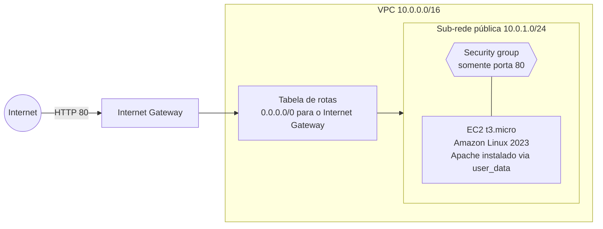
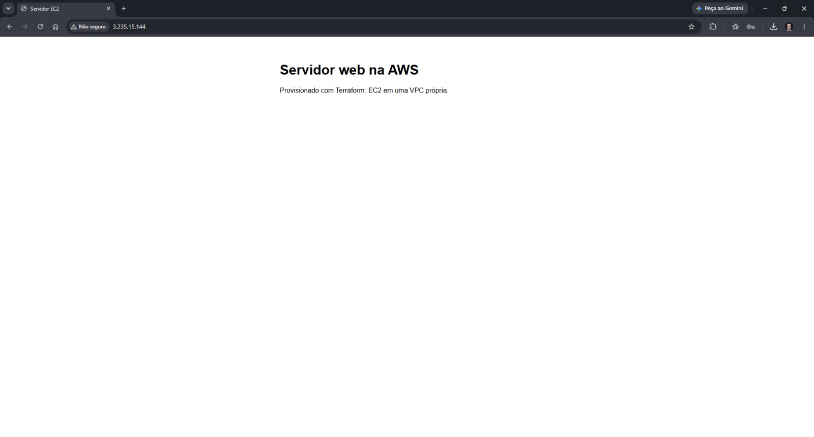
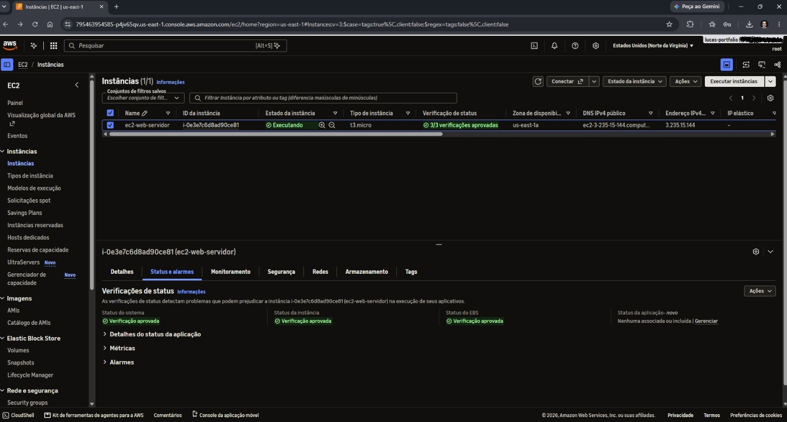
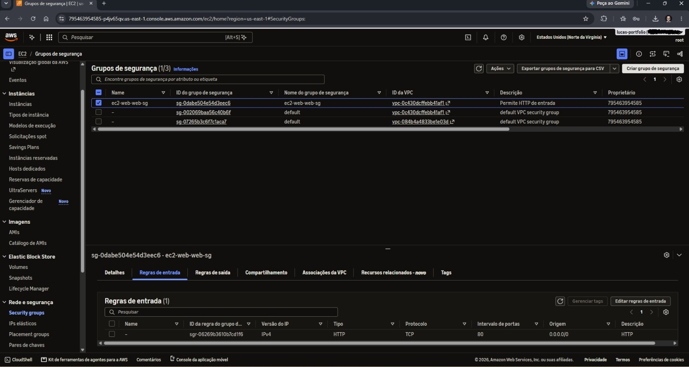
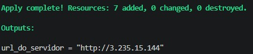

# Servidor web em EC2 com Terraform

Servidor web em EC2 dentro de uma VPC própria, provisionado 100% com Terraform, sem SSH exposto e com custo controlado.

## Resumo em 30 segundos

Neste projeto criei, por código, um **servidor na nuvem da AWS** com uma página web no ar. O Terraform monta a rede, liga o servidor e um script instala o programa web sozinho, sem que eu precise entrar na máquina. A segurança foi planejada desde o início: nenhuma porta de administração aberta e disco criptografado. Ao terminar, tudo é removido com um comando.

## Arquitetura



## Evidências

**1. Página servida pelo EC2:**



**2. Instância criada na AWS (`t3.micro`, em execução):**



**3. Security group: somente a porta 80 aberta, sem SSH:**



**4. Execução do Terraform:**



```text
Apply complete! Resources: 7 added, 0 changed, 0 destroyed.
```

## Decisões e trade-offs

| Decisão | Por quê | Alternativa | O que perdi |
|---|---|---|---|
| **Terraform em vez do console** | Ambiente repetível, versionado e revisável | Criar pelo console | Curva de aprendizado inicial |
| **VPC própria, sem usar a default** | Controle total e entendimento do que a rede faz | Usar a VPC default | Mais código |
| **Sem SSH (porta 22)** | Portas administrativas expostas são alvo constante de ataques automatizados | SSH restrito ao meu IP, ou acesso via SSM | Não consigo entrar no servidor para depurar. A depuração é feita pelo log do sistema no console |
| **`user_data` para configurar o servidor** | Mantém a infraestrutura 100% como código | Instalar manualmente por SSH | Se o script falhar, o erro é silencioso |
| **IMDSv2 obrigatório** | Protege os metadados da instância contra SSRF | Padrão antigo (IMDSv1) | Nenhum relevante |
| **Disco criptografado** | Proteção dos dados em repouso | Disco sem criptografia | Praticamente nenhum |
| **`t3.micro`** | Tipo elegível ao plano gratuito para contas criadas depois de julho de 2025 | `t2.micro` | Nenhum, o `t2.micro` não é elegível na conta |
| **AMI mais recente via `data`** | Sempre traz as correções de segurança mais novas | Fixar o ID da AMI | Menos reprodutível: o mesmo código pode gerar servidores ligeiramente diferentes |
| **Uma sub-rede e uma zona** | Um servidor único não ganha nada com duas sub-redes | Duas zonas, como no projeto da VPC | Se a zona cair, o servidor cai. Aceitável para demo |
| **Só HTTP, sem HTTPS** | Sem domínio nem certificado, não há como emitir HTTPS | ALB com certificado do ACM | O navegador marca "não seguro" |
| **Servidor em sub-rede pública** | Mantém o projeto simples e de baixo custo | Servidor em sub-rede privada atrás de um balanceador de carga | Maior exposição. Em produção, o desenho correto usa sub-rede privada e balanceador |

## Limitações conhecidas

Este projeto é uma demonstração. Em produção eu faria diferente em três pontos: o servidor ficaria em sub-rede privada, atrás de um Application Load Balancer com HTTPS; o acesso administrativo seria feito via AWS Systems Manager (SSM); e o tráfego de saída seria restrito por destino.

## Tecnologias

- AWS: EC2, VPC, Internet Gateway, security groups
- Terraform (provider `aws`)
- Amazon Linux 2023 e Apache (httpd)
- Git e GitHub

## Como reproduzir

Pré-requisitos: conta AWS, AWS CLI e Terraform instalados, e um usuário IAM configurado no CLI.

```bash
git clone https://github.com/coutolucasdev/aws-ec2-webserver-terraform.git
cd aws-ec2-webserver-terraform

# Confirme a conta antes de criar recursos
aws sts get-caller-identity

terraform init
terraform plan
terraform apply
```

Ao final, o Terraform exibe a `url_do_servidor`. Aguarde de 1 a 3 minutos para o script de inicialização terminar. Abra o endereço com `http://`.

## Custo

A rede (VPC, sub-rede, Internet Gateway, tabela de rotas e security group) não é cobrada. O servidor EC2 e o endereço IPv4 público são cobrados por hora de uso. Em uma conta no plano gratuito, esse consumo sai dos créditos. Consulte a página oficial de preços da AWS para os valores atuais. Por isso, o ambiente é criado, testado e removido na mesma sessão.

## Como remover tudo

```bash
terraform destroy
```

## O que aprendi

Aprendi que o `user_data` permite configurar um servidor sem entrar nele, mas que a depuração fica mais difícil sem SSH, e por isso o log do sistema no console passou a ser minha ferramenta. Também entendi o raciocínio por trás de cada medida de segurança, como IMDSv2, disco criptografado e firewall mínimo, e que um servidor em sub-rede pública é um atalho consciente para um demo, e não o desenho de produção. Descobri ainda que o tipo de instância gratuito depende da data de criação da conta, e que vale conferir isso antes de criar recursos.

## Próximo passo

Evoluir este projeto para um desenho mais próximo de produção: servidor em sub-rede privada, Application Load Balancer, HTTPS e acesso por SSM.

## Autor

Lucas Couto | AWS Certified Cloud Practitioner
[LinkedIn](https://www.linkedin.com/in/lucascoutoaraujo)